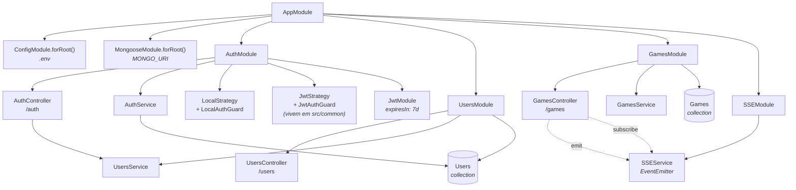
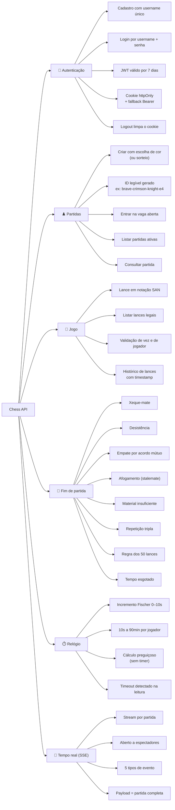
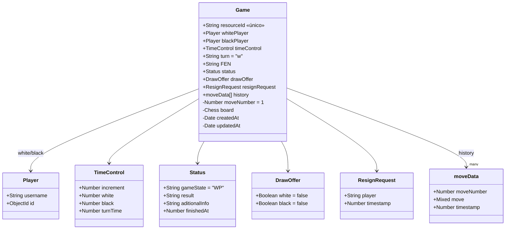
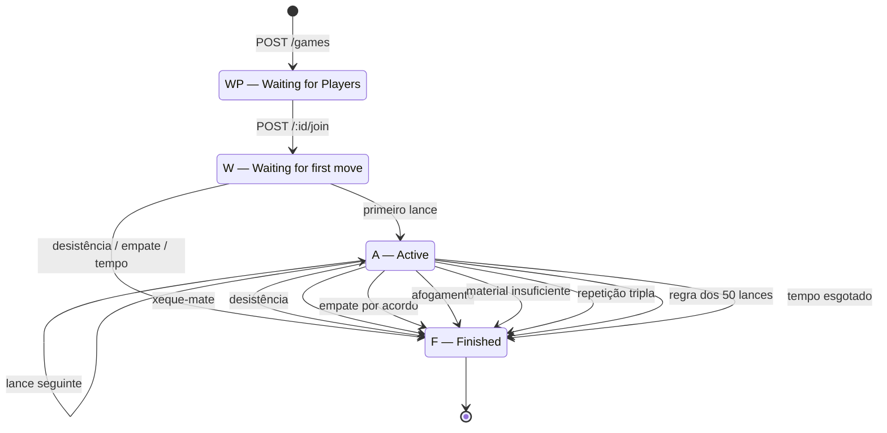
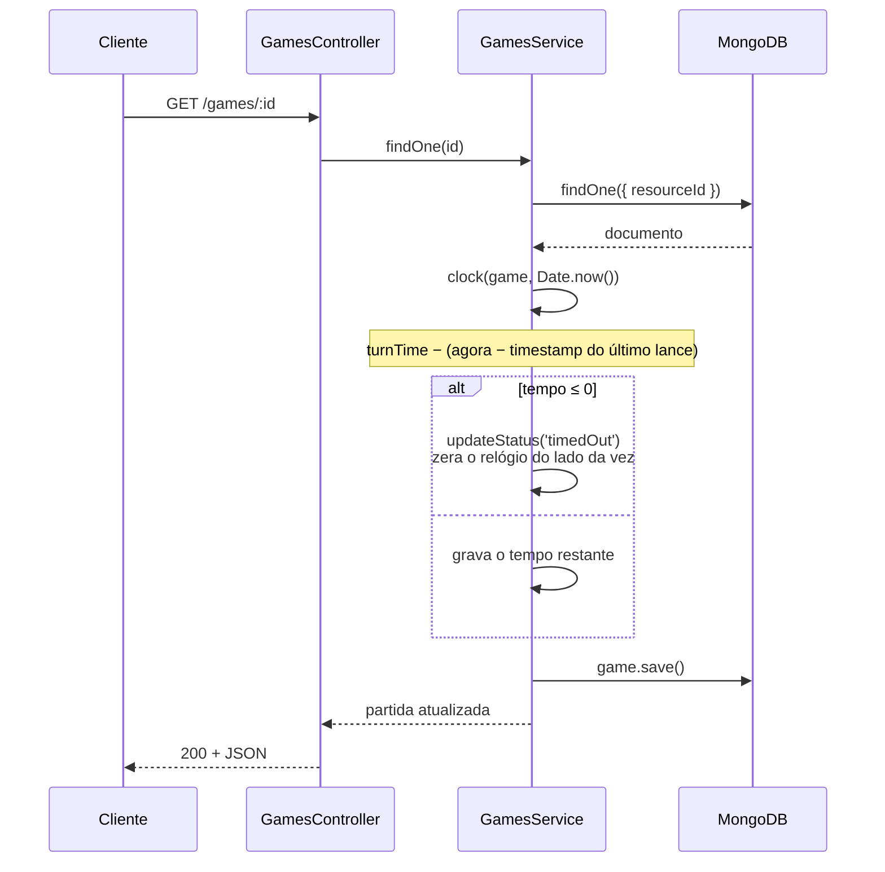
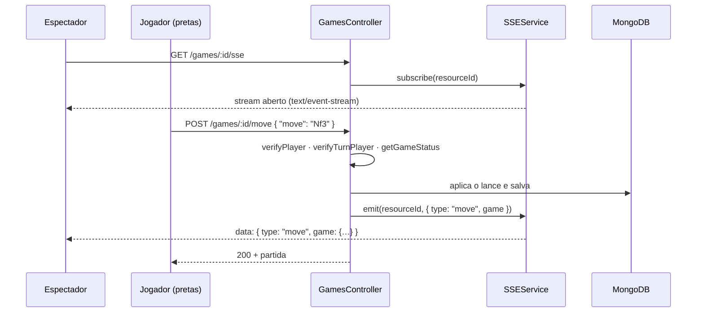
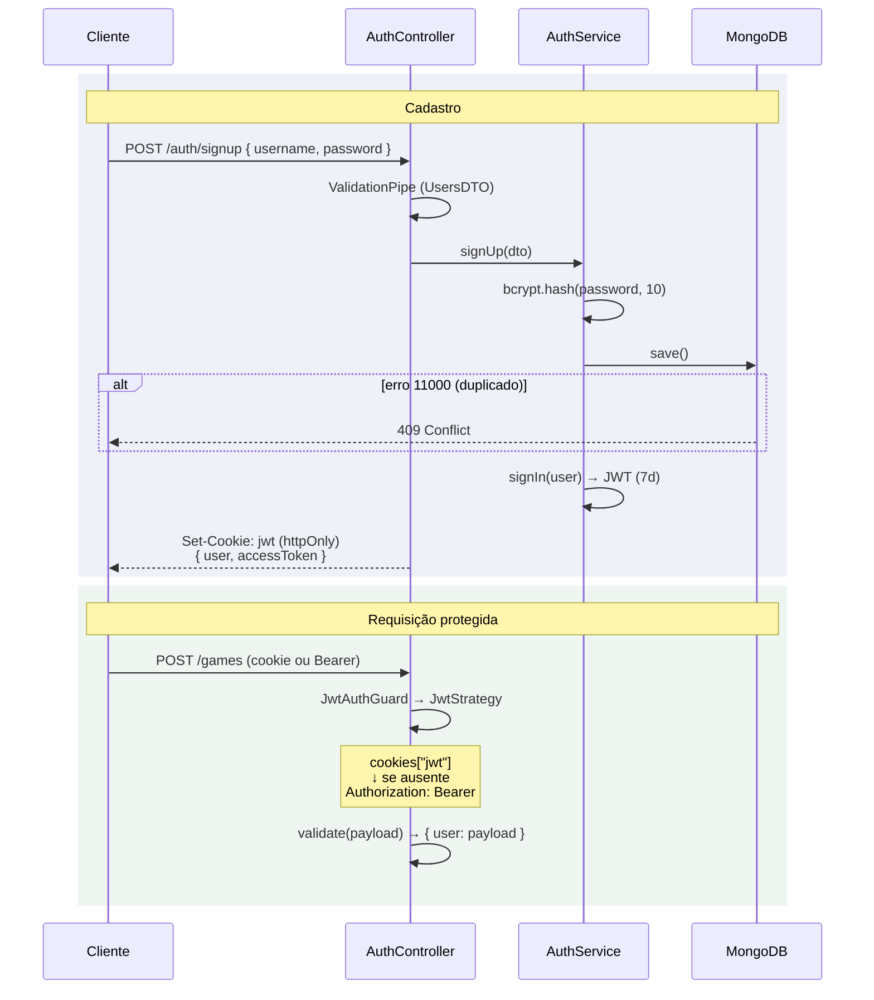

# Chess API — Documentação da versão legada

> Estado do repositório em `80c7480`, o commit imediatamente anterior a
> `eae6b37` ("I did what HAD to be done..."), que apagou toda a base de código
> em 31/01/2024 para dar início à reescrita.
>
> **Período:** 28/07/2022 → 31/01/2024 · **132 commits** · **42 arquivos** · ~1.700 linhas de TS
>
> Objetivo deste documento: recuperar o conhecimento funcional que existia na
> versão antiga — o que a API fazia, como fazia, e o que estava errado — para
> servir de mapa na conclusão da reescrita.

---

## 1. O que é

Uma API REST de **xadrez multiplayer assíncrono**. Dois jogadores se conectam a
uma partida identificada por um ID legível (ex.: `brave-crimson-knight-e4`),
jogam alternando lances em notação SAN, e qualquer pessoa pode acompanhar a
partida em tempo real via **Server-Sent Events** — sem precisar estar logada.

Três características definem o desenho:

1. **O estado do tabuleiro mora no MongoDB**, não em memória. Cada requisição
   recarrega a partida do banco. Não há sessão, sala ou processo por jogo.
2. **O relógio é preguiçoso (lazy)**. Não existe timer, cron ou worker. O tempo
   restante é recalculado a partir de `Date.now()` toda vez que a partida é lida.
3. **SSE só para notificação**, nunca como fonte da verdade. O evento carrega o
   estado novo da partida, mas o cliente sempre pode reconstruir tudo via `GET`.

### Stack

| Camada | Tecnologia |
|---|---|
| Runtime | Node.js |
| Framework | NestJS 9 |
| Linguagem | TypeScript 4.9 (`strict` desligado) |
| Banco | MongoDB via Mongoose 6 |
| Autenticação | Passport (`local` + `jwt`), JWT em cookie httpOnly |
| Hash de senha | bcrypt, 10 salt rounds |
| Motor de xadrez | **`github:Utzig26/chess.js#dev`** — fork próprio |
| Tempo real | `@Sse` do Nest + `EventEmitter` + RxJS `fromEvent` |
| IDs legíveis | `unique-names-generator` |

> ⚠️ **O fork do chess.js é o ponto mais crítico da arquitetura antiga.** O
> schema persiste o objeto `Chess` inteiro no Mongo (`@Prop({ type: Chess })`)
> e o reidrata com `new Chess(game.board)` — passando um **objeto**, não uma
> string FEN. O chess.js oficial não aceita isso. Ver §9.1.

---

## 2. Árvore de módulos



### Duplicação de providers (dívida real)

Dois serviços são declarados em `providers` de módulos que **também** importam o
módulo dono deles. No Nest, o provider local vence — então existem **duas
instâncias** de cada um:

| Serviço | Dono | Também declarado em | Consequência |
|---|---|---|---|
| `UsersService` | `UsersModule` | `AuthModule`, `GamesModule` | 3 instâncias. Inofensivo hoje (stateless), mas errado. |
| `SSEService` | `SSEModule` | `GamesModule` | 2 `EventEmitter` distintos. **Funciona por acidente**: `subscribe` e `emit` são chamados no mesmo `GamesController`, que resolve para a instância local. Se um segundo módulo tentasse emitir via `SSEModule`, os eventos sumiriam. |

O certo seria remover das listas de `providers` e depender apenas do `exports`
dos módulos importados.

---

## 3. Estrutura de arquivos

```
src/
├── main.ts                          # bootstrap: CORS + cookie-parser, porta 3000
├── app.module.ts                    # raiz: Config, Mongoose, Auth, Users, Games, SSE
├── app.controller.ts                # vazio
├── app.service.ts                   # vazio
│
├── auth/
│   ├── auth.module.ts
│   ├── auth.controller.ts           # POST /auth/{signup,signin,signout}
│   ├── auth.service.ts              # signUp, signIn, validateUser
│   ├── guards/
│   │   └── local-auth-guard.ts      # AuthGuard('local')
│   └── strategies/
│       └── local.strategy.ts        # valida username + senha
│
├── common/
│   ├── guards/
│   │   └── jwt-auth.guard.ts        # AuthGuard('jwt')
│   └── strategies/
│       └── jwt.strategy.ts          # extrai JWT do cookie, cai p/ Bearer
│
├── users/
│   ├── users.module.ts
│   ├── users.controller.ts          # GET /users/me
│   ├── users.service.ts             # findById, extractUserData
│   ├── dto/users.dto.ts             # UsersDTO — regras de username/senha
│   ├── interfaces/users.interface.ts
│   └── schemas/users.schema.ts      # username único + password hash
│
├── games/                           # ~800 linhas — o núcleo
│   ├── games.module.ts
│   ├── games.controller.ts          # 9 rotas, 192 linhas
│   ├── games.service.ts             # 339 linhas: regras + relógio + estado
│   ├── dto/games.dto.ts             # newGameDTO, moveDTO, timeControl
│   ├── interfaces/games.interface.ts
│   └── schemas/games.schema.ts      # 7 classes, 184 linhas
│
└── sse/
    ├── sse.module.ts
    └── sse.service.ts               # 19 linhas: EventEmitter + fromEvent
```

**Cobertura de testes: zero.** Existem três `.spec.ts` de scaffold
(`app.controller`, `auth.service`, `games.service`) com apenas
`expect(service).toBeDefined()` — e que nem passariam, porque instanciam os
services sem mockar as dependências injetadas (`@InjectModel`, `JwtService`).
O `app.e2e-spec.ts` só verifica que `GET /` devolve 404.

---

## 4. Features



---

## 5. Endpoints

Legenda: 🔓 público · 🔒 exige JWT

### `/auth`

| | Rota | Corpo | Resposta |
|---|---|---|---|
| 🔓 | `POST /auth/signup` | `{ username, password }` | `{ user: {id, username}, accessToken }` + cookie `jwt` |
| 🔓 | `POST /auth/signin` | `{ username, password }` | `{ accessToken }` + cookie `jwt` |
| 🔒 | `POST /auth/signout` | — | `{ message: "success" }`, limpa o cookie |

**Validação de cadastro** (`UsersDTO`):

- `username`: 2–32 caracteres, regex `/^(?![_.])(?!.*[_.]{2})[a-zA-Z0-9._]+(?<![_.])$/`
  — alfanumérico, `_` e `.`; não pode começar nem terminar com `_`/`.`, nem ter dois seguidos.
- `password`: 8–128 caracteres, sem exigência de composição.

Username duplicado → o erro `11000` do Mongo vira `409 Conflict`.

### `/users`

| | Rota | Resposta |
|---|---|---|
| 🔒 | `GET /users/me` | `{ id, username }` |
| 🔒 | `GET /users` | idem — alias registrado no mesmo handler |

O alias existe porque `/users` ainda não lista usuários; a intenção documentada
era manter só `/users/me` no contrato público.

### `/games`

| | Rota | Pré-condição | Efeito |
|---|---|---|---|
| 🔓 | `GET /games/:id/sse` | — | Abre o stream SSE da partida |
| 🔓 | `GET /games` | — | Lista partidas com `gameState == "A"` |
| 🔓 | `GET /games/:id` | — | Devolve a partida (404 se não existir) |
| 🔓 | `GET /games/:id/moves` | estado `W` ou `A` | `{ game, moves: string[] }` — lances legais |
| 🔒 | `POST /games` | — | Cria a partida |
| 🔒 | `POST /games/:id/join` | estado `WP` | Ocupa a vaga livre → estado `W` |
| 🔒 | `POST /games/:id/move` | é jogador · é sua vez · estado `W`/`A` | Aplica o lance |
| 🔒 | `POST /games/:id/resign` | é jogador · estado `W`/`A` | Desiste |
| 🔒 | `POST /games/:id/draw` | é jogador · estado `W`/`A` | Oferece/aceita empate |
| 🔒 | `DELETE /games/:id/draw` | é jogador · estado `W`/`A` | Retira a própria oferta |

**Corpo de `POST /games`** (`newGameDTO`):

```json
{
  "pieces": "w",
  "timeControl": { "white": 600, "black": 600, "increment": 5 }
}
```

- `pieces`: `"w"` | `"b"`, opcional — se omitido, a cor é **sorteada**.
- `white` / `black`: 10–5400 segundos.
- `increment`: 0–10 segundos.

**Corpo de `POST /games/:id/move`** (`moveDTO`):

```json
{ "move": "Nf3" }
```

Validado por regex SAN antes de chegar ao motor:
`/^([PNBRQK]?[a-h]?[1-8]?[xX-]?[a-h][1-8](=[NBRQ]| ?e\.p\.)?|^O-O(?:-O)?)[+#$]?$/`
— cobre lances de peça e peão, capturas, promoção, *en passant* e roque.

#### Não existe endpoint de "aceitar empate"

O empate é modelado como **dois booleanos** (`drawOffer.white`, `drawOffer.black`).
Aceitar é simplesmente chamar `POST /:id/draw` também. Quando os dois ficam
`true`, a partida encerra em empate. `DELETE /:id/draw` zera apenas a sua flag.

---

## 6. Modelo de dados

### Coleção `Users`

| Campo | Tipo | Notas |
|---|---|---|
| `username` | `String` | **único**, obrigatório |
| `password` | `String` | hash bcrypt (10 rounds) |

### Coleção `Games`



Campos marcados com `-` levam `@Exclude()` e **não saem na resposta** — o
`ClassSerializerInterceptor` no `GamesController` cuida disso. É por essa razão
que o objeto `Chess` inteiro e o `_id` do Mongo nunca vazam para o cliente.

Além disso, `whitePlayer` e `blackPlayer` passam por um `@Transform` que
**reduz o objeto ao `username`**:

```ts
@Transform(({ value }) => value ? value.username : undefined)
```

Ou seja, a API devolve `"whitePlayer": "Magnus.Carlsen"`, nunca o `id`. O
cliente não tem como descobrir por ID qual lado é seu — precisa comparar pelo
username do `/users/me`.

### Geração do `resourceId`

`unique-names-generator` monta `<adjetivo>-<cor>-<substantivo>-<casa>`, onde o
substantivo sai aleatoriamente de uma lista de peças de xadrez **ou** de animais,
e a "casa" é uma coordenada tipo `e4`:

```
brave-crimson-knight-e4
tidy-olive-panda-h7
```

A criação faz um loop `do … while` consultando o banco até achar um ID livre.

---

## 7. Máquina de estados da partida

`status.gameState` assume quatro valores:



Cada transição preenche `status.aditionalInfo` com uma frase legível e, ao
finalizar, grava `status.result` (`"White wins"`, `"Black wins"` ou `"Draw"`) e
`status.finishedAt`.

**Detalhe importante:** `updateStatus()` **sempre reconsulta o tabuleiro antes
de olhar o motivo pedido**. Se a posição já é xeque-mate, o tipo solicitado é
sobrescrito:

```ts
const board = new Chess(game.board)
if (board.isCheckmate())               type = 'checkMate';
else if (board.isInsufficientMaterial()) type = 'insufficientMaterial';
else if (board.isStalemate())            type = 'stalemate';
else if (board.isThreefoldRepetition())  type = 'threefoldRepetition';
else if (board.isDraw())                 type = '50-moveRule';
switch (type) { … }
```

Isso é elegante para detecção automática de fim de jogo, mas significa que uma
desistência numa posição já empatada por material insuficiente é registrada
como empate, não como desistência.

---

## 8. Os dois mecanismos que valem a pena preservar

### 8.1 Relógio preguiçoso

Não existe timer, `setInterval`, worker ou job. O tempo é derivado.



`timeControl.turnTime` é o **snapshot do relógio de quem tem a vez**, tirado no
instante do último lance. `clock()` subtrai daí o tempo decorrido. Se o
resultado for ≤ 0, quem estava na vez perde por tempo — e isso é descoberto na
próxima leitura, seja de quem for.

O incremento Fischer é aplicado em `updateTimeControl()`, chamado dentro de
`move()` **antes** de `game.turn` ser trocado (portanto `game.turn` ainda é
quem acabou de jogar):

```ts
const timeSpent = increment - ((moves[1].timestamp - moves[0].timestamp) / 1000);
game.timeControl.white = game.timeControl.turnTime + timeSpent;  // se branco jogou
game.timeControl.turnTime = game.timeControl.black;              // agora é a vez das pretas
```

**Vantagem:** stateless de verdade. Escala horizontal sem coordenação, sobrevive
a restart do processo.
**Custo:** um `GET` escreve no banco (§9.2), e ninguém é notificado do timeout
até alguém consultar.

### 8.2 SSE

O `SSEService` inteiro cabe em 19 linhas:

```ts
@Injectable()
export class SSEService {
  readonly emitter: EventEmitter;
  constructor() { this.emitter = new EventEmitter(); }

  subscribe(id: string) { return fromEvent(this.emitter, id); }

  async emit(id: string, data: Object) { return this.emitter.emit(id, { data }); }
}
```

O `resourceId` da partida é o nome do evento no `EventEmitter`. O `@Sse()` do
Nest consome o `Observable` do `fromEvent` e serializa cada emissão como um
evento SSE.



**Eventos emitidos** — sempre `{ type, game }`, com `game` já serializado:

| `type` | Disparado por |
|---|---|
| `join` | `POST /:id/join` |
| `move` | `POST /:id/move` |
| `resign` | `POST /:id/resign` |
| `drawOffer` | `POST /:id/draw` |
| `drawCancel` | `DELETE /:id/draw` |

**Características e limites:**

- **Sem autenticação** no `@Sse` — qualquer um assiste qualquer partida. Isso é
  provavelmente intencional (espectadores), mas vale decidir conscientemente na
  reescrita.
- **Em memória, por processo.** Com mais de uma instância da API, um cliente
  conectado à instância A não recebe o lance processado pela instância B. Para
  escalar horizontalmente é preciso um Redis Pub/Sub ou equivalente.
- **Sem replay, sem heartbeat, sem `Last-Event-ID`.** Reconexão perde o que
  passou; a recuperação é refazer o `GET /games/:id`.
- **O relógio não gera evento.** O fim por tempo só aparece quando alguém lê a
  partida — o espectador pode ficar olhando uma partida já encerrada.

---

## 9. Fluxo de autenticação



A `JwtStrategy` tenta o cookie primeiro e só então o header:

```ts
jwtFromRequest: ExtractJwt.fromExtractors([(request: Request) => {
  const data = request?.cookies["jwt"];
  if (!data) {
    try { return request?.headers.authorization.replace('Bearer ',''); }
    catch { return null; }
  }
  return data;
}])
```

O `validate()` devolve `{ user: payload }` — e é por isso que todos os
controllers escrevem `req.user['user']`, um aninhamento estranho que se
propagou por toda a base.

O payload do JWT tem só `{ id, username }`. **`signout` apenas limpa o cookie**:
o token continua válido pelos 7 dias, e quem tiver guardado o `accessToken`
segue autenticado. Não há blacklist nem refresh token.

### Variáveis de ambiente

| Variável | Uso |
|---|---|
| `MONGO_URI` | conexão do Mongoose |
| `JWT_SECRET` | assinatura e verificação do JWT |
| `CORS_ORIGIN` | origem única permitida (`credentials: true`, métodos `POST` e `GET`) |

Lidas via `process.env` direto, sem schema de validação — se faltarem, a
aplicação sobe e quebra em runtime.

---

## 10. Bugs e dívidas identificados

Levantamento feito na leitura do código, ordenado por gravidade. Serve de
checklist do que **não** repetir na reescrita.

### 🔴 Bugs reais

**1. A verificação de partida inexistente no SSE nunca dispara**
`games.controller.ts:35` — falta o `await`:

```ts
const game = this.gamesService.findOne(id)   // ← Promise, sempre truthy
if (!game) throw new HttpException('Game not found.', HttpStatus.NOT_FOUND);
```

Resultado: `GET /games/id-inexistente/sse` abre um stream que nunca emite nada,
em vez de devolver 404. É a única chamada a `findOne` sem `await` no arquivo.

**2. O criador pode jogar sozinho contra si mesmo**
`getGameStatus(game, 'join')` só confere se o estado é `WP`. Ninguém verifica se
quem está entrando é o próprio criador — então ele ocupa as duas cores. A
função `wichPlayer()` inclusive trata esse caso explicitamente devolvendo
`'wb'`, e `drawRequest` sabe empatar consigo mesmo. Pode ter sido intencional
(modo treino), mas não está documentado em lugar nenhum.

**3. O primeiro lance das brancas é grátis**
Em `updateTimeControl`, quando o histórico tem só 1 lance a função apenas define
`turnTime = timeControl.black` e retorna, sem debitar o tempo que as brancas
levaram para jogar.

**4. FEN inicial incompleto**
`games.schema.ts:5` — `'rnbqkbnr/pppppppp/8/8/8/8/PPPPPPPP/RNBQKBNR'` não tem os
campos de vez, roque, *en passant* e contadores (` w KQkq - 0 1`). É só o valor
default do campo `FEN` (o tabuleiro real vem do objeto `Chess`), mas qualquer
cliente que confie nesse FEN antes do primeiro lance recebe uma string inválida.

**5. Mensagem de validação trocada**
`users.dto.ts:11` — `@MaxLength(32, { message: 'Username must be at least 32 characters long' })`.
Deveria ser "at most".

### 🟠 Problemas de arquitetura

**6. `GET` escreve no banco**
`findOne()` chama `clock()`, que chama `game.save()`. Toda leitura de partida é
uma escrita. Além de violar a semântica de `GET`, isso multiplica a carga no
Mongo por leitura e cria corrida quando vários clientes consultam ao mesmo tempo.

**7. SSE não sobrevive a mais de uma instância**
`EventEmitter` em memória (§8.2). Escala horizontal exige um broker.

**8. Instâncias duplicadas de providers** — ver §2.

**9. Nenhuma proteção contra corrida em lances simultâneos**
`findOne` → valida → `save()` sem transação nem `optimistic concurrency`. Dois
`POST /move` simultâneos podem ler o mesmo estado e o último sobrescreve o
primeiro.

**10. Toda a lógica de negócio em funções soltas no fim do service**
`wichPlayer`, `updateTimeControl`, `updateStatus`, `selectPieces`,
`generateResourceId` são funções módulo-privadas em `games.service.ts`, fora da
injeção de dependência e portanto intestáveis isoladamente. `updateStatus` é um
`switch` de 85 linhas.

**11. Validação repetida em todo handler**
O padrão `findOne` → `if (!game) 404` → `getGameStatus` → `verifyPlayer` se
repete em 6 dos 9 handlers. É exatamente o caso de uso de um guard ou
interceptor — que, aliás, é o que a reescrita já introduziu.

**12. `strictNullChecks: false` e `noImplicitAny: false`**
O `tsconfig.json` desliga as duas verificações mais úteis do TypeScript. Daí
vêm construções como `verifyPlayer` declarada `Promise<boolean>` mas com
`return null` no caminho de erro.

### 🟡 Segurança

**13. `signout` não invalida nada** — o JWT segue válido por 7 dias (§9).
**14. Sem rate limiting** em `signin`/`signup`.
**15. Cookie sem `secure` nem `sameSite`** — `response.cookie('jwt', token, { httpOnly: true })`.
**16. Sem exigência de composição de senha** — 8 caracteres quaisquer.

### 🔵 Cosméticos

Erros de grafia que ficaram no **contrato público da API** e precisam de decisão
consciente na reescrita (corrigir quebra clientes):

| Onde | Escrito | Correto |
|---|---|---|
| `status.aditionalInfo` | `aditional` | `additional` |
| `status.aditionalInfo` (valor default) | `"Wating for the players connect"` | `"Waiting for the players to connect"` |
| `status.aditionalInfo` (join) | `"Wating for the first move."` | `"Waiting…"` |
| `games.service.ts` | `wichPlayer` | `whichPlayer` |
| `games.schema.ts` | `initalFEN` | `initialFEN` |
| `games.controller.ts:96` | `'This game is no more joinable .'` | espaço antes do ponto |

O `README.md` nunca foi escrito — era o boilerplate do NestJS do início ao fim.

---

## 11. Resumo para a reescrita

**O que vale trazer:**

- O relógio preguiçoso (§8.1). É simples, correto e escala.
- O modelo de empate por dois booleanos (§5) — evita um endpoint de "aceitar".
- A detecção automática de fim de jogo consultando o motor antes de aplicar o
  motivo pedido (§7).
- Os IDs legíveis (§6) — muito melhor que ObjectId numa URL compartilhável.
- O `@Transform` que esconde IDs de jogador na serialização (§6).
- O fallback cookie → Bearer na `JwtStrategy` (§9).

**O que exige decisão antes de continuar:**

1. **O fork do chess.js.** Persistir o objeto `Chess` foi o que forçou o fork.
   Guardar só o FEN + histórico SAN e reidratar com o chess.js oficial elimina
   a dependência de um fork pessoal não mantido — ao custo de recomputar a
   posição a cada requisição (barato) e de perder o estado interno de repetição
   tripla, que precisaria ser derivado do histórico.
2. **SSE distribuído ou instância única?** Define se entra Redis.
3. **Escrita no caminho de leitura.** Manter o relógio preguiçoso sem `save()`
   no `GET` significa calcular na resposta e só persistir quando houver
   mutação — ou aceitar o timeout ser detectado tarde.
4. **Corrigir os erros de grafia no contrato** ou manter compatibilidade.
5. **Jogar contra si mesmo:** feature ou bug?

---

# Parte II — O que a reescrita já mudou

> Estado da master em `e00c87f`, lido em 25/07/2026.

## 12. Onde a master está

| | Hoje | Legado |
|---|---|---|
| Módulos de domínio | 2 (`auth`, `users`) | 4 |
| Endpoints | 2 | 15 |
| Linhas de TS | 484 | ~1.700 |
| Rotas protegidas | 0 | 8 |
| Testes | 0 | 0 |
| NestJS | 11 | 9 |

`games` e `sse` — os dois módulos que continham a razão de existir da API — ainda
não foram tocados. O `UsersController` existe mas está vazio: nem o `/users/me` voltou.

### A camada `utils/` é a mudança estrutural real

Três peças transversais registradas no `main.ts` substituem o
`throw new HttpException(...)` repetido em cada handler do legado:

- `GlobalExceptionFilter` — captura tudo, normaliza o envelope de erro, loga via `Logger`.
- `MongoExceptionFilter` — traduz `MongoError` (hoje só o `11000`).
- `GlobalResponseInterceptor` — embrulha as respostas de sucesso, lendo a mensagem
  do `@WrapMessage` via `Reflector`.

O `@WrapMessage('User created')` é o detalhe bem resolvido: a mensagem vira
metadado do endpoint em vez de `if` dentro do controller.

**Contrato de resposta — antes e depois:**

```jsonc
// Legado: cada rota inventava a sua
{ "user": { "id": "…", "username": "magnus" }, "accessToken": "eyJ…" }

// Master: um envelope para tudo
{
  "success": true, "statusCode": 201,
  "timestamp": "…", "path": "/auth/signup",
  "message": "User created",
  "data": { "access_token": "eyJ…" }
}
```

### Outros ganhos concretos

- `@Prop({ select: false })` na senha — o hash não sai do banco por acidente.
- `lowercase: true` no username — fecha o buraco de `Magnus` vs `magnus`.
- DTOs segregados: `UserCreateDto`, `UserSignDto` (via `PickType`), `UserDto`.
- bcrypt encapsulado em métodos `private` do `UsersService`.
- Mensagens de validação corretas — o bug §10.5 morreu.
- `HydratedDocument<User>` no lugar da interface escrita à mão.
- Credenciais de conexão separadas (`DB_URI`, `DB_NAME`, `DB_USERNAME`, `DB_PASSWORD`).
- `docker-compose.yml` — Mongo local versionado, não existia.
- `AuthModule` importa e reusa o `UsersModule`: a duplicação de providers do §2 acabou.

## 13. Veredito das dívidas do §10

| # | Dívida | Hoje |
|---|---|---|
| 01 | SSE sem `await` | não portado |
| 02 | Criador joga sozinho | não portado |
| 03 | Primeiro lance grátis | não portado |
| 04 | FEN inicial incompleto | não portado |
| 05 | Mensagem "at least 32" | ✅ resolvido |
| 06 | `GET` escreve no banco | não portado |
| 07 | SSE preso a uma instância | não portado |
| 08 | Providers duplicados | ✅ resolvido |
| 09 | Corrida em lances | não portado (mas o padrão racy voltou — §14.7) |
| 10 | Lógica em funções soltas | 🟠 parcial |
| 11 | Validação repetida | ✅ resolvido |
| 12 | `strict` desligado | ❌ pendente |
| 13 | `signout` não invalida | 🟠 sumiu junto com a rota |
| 14 | Sem rate limiting | ❌ pendente |
| 15 | Cookie sem `secure`/`sameSite` | 🟠 cookie removido (TODO no `main.ts`) |
| 16 | Grafia no contrato | ✅ contrato refeito do zero |

Quatro resolvidas, três pendentes, três que só sumiram junto com o código.
As nove restantes voltam a valer quando `games` e `sse` forem escritos.

## 14. O que quebrou no caminho

### 🔴 Crítico — verificados em execução

**1. Qualquer senha autentica qualquer usuário** — `users.service.ts:25`:

```ts
if (!this.comparePassword(userSignDto.password, user.password)) return null;
//  ↑ async: testa uma Promise, sempre truthy
```

`!Promise` é sempre `false`, então `checkPassword` devolve o usuário
independentemente da senha. Mesma classe de erro do §10.1, agora no caminho de auth.

**2. O `sub` do JWT é `undefined`** — `user.schema.ts:8`. A prop `id: string`
sombreia o virtual `id` do Mongoose. Testado: `doc.id` devolve `undefined` com o
schema atual, e o `_id` correto sem a prop.

**Por que nada disso apareceu:** a `JwtStrategy` recebe o payload `{ sub, username }`
mas está tipada como `UserSignDto` e o repassa para `checkPassword` com
`password: undefined`. `bcrypt.compare(undefined, hash)` rejeita — o guard só não
explode porque o bug nº 1 impede que o resultado seja aguardado.
**Consertar o `await` sozinho derruba a validação do JWT.**

### 🟠 Arquitetura

3. JWT expira em **60 segundos** (`auth.module.ts:16`) — sobra de teste.
4. Só Bearer: o fallback cookie→header do §9 sumiu, `cookie-parser` está comentado.
5. `JwtAuthGuard` existe mas `@UseGuards` não aparece em lugar nenhum.
6. CORS desapareceu do `main.ts`.
7. A checagem de duplicidade virou racy: `findOne` antes do insert, em vez de
   deixar o índice único decidir. E o `MongoExceptionFilter` faz `throw` dentro do
   `catch()` — exceções lançadas por um filter não reentram na cadeia, escapando
   do envelope JSON.

### 🔵 Pontas soltas

- `jwt.strategy.ts:19` — `console.log(userSignDto)` a cada requisição.
- `users.service.ts:11` — `logger: Logger;` declarado, nunca instanciado.
- `users.service.ts:36` — documento construído duas vezes (`new` + `create`).
- `utils/interpectors/` — grafia errada, e o `Reflector` é instanciado à mão
  dentro do `intercept()` porque o interceptor é registrado com `new` no `main.ts`
  em vez de via `APP_INTERCEPTOR`.

## 15. Caminho até a paridade

1. **Fechar o buraco de autenticação** — o `await`, a prop `id`, e reescrever
   `JwtStrategy.validate` para confiar no payload assinado. Depois, `expiresIn`
   utilizável.
2. **Provar o caminho autenticado** — trazer `/users/me` de volta com o
   `JwtAuthGuard`. Menor rota que exercita guard, strategy, envelope e filtros.
3. **Escrever os primeiros testes** — os dois bugs críticos morreriam num único
   teste de "senha errada deve falhar". O `test:e2e` também está quebrado por
   falta de `moduleNameMapper`.
4. **Ligar `strictNullChecks`** — com 484 linhas o custo é baixo; com `games`
   escrito, será alto.
5. **Decidir sobre o chess.js** (§11.1) antes da primeira linha de `games`.
6. **Portar `games`, depois `sse`**, usando a Parte I como especificação.
